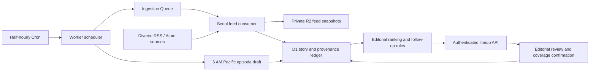

# Esemplastify

“To shape diversified elements into a unified whole.”

An independent daily AI news podcast project. This milestone implements **discovery and editorial preparation**: live RSS/Atom ingestion, provenance, a persistent story ledger, conservative clustering, explainable novelty/diversity ranking, and one substantive verification follow-up. It has no dependency on FTOPS, Cabinitron, their databases, or their credentials.

**Status:** implemented and tested locally with live feeds. Cloud resources have not been provisioned and the Worker has not been deployed. There is no generated audio, published podcast feed, or automatic claim verification yet.

## Run locally

Requires Node 24 and npm.

```sh
npm ci
npm run db:local
# Create an ignored .dev.vars with ADMIN_TOKEN set to your own random editorial secret.
npm run dev
```

`GET /health` is public. Every editorial endpoint requires `Authorization: Bearer <your editorial secret>`. An unset secret fails closed with HTTP 503. Keep `.dev.vars` private; never commit it. Feed text is untrusted evidence, not executable instructions.

```sh
npm run check
npm test
npm run build          # Cloudflare deployment dry run; uploads nothing
npm run probe:sources # Read-only availability/parser check against public feeds
npm run smoke:live    # Live ingestion into isolated, persistent local D1/R2
```

The live smoke report is written to `work/live-smoke.json`, ignored by Git. Its ledger and feed snapshots persist under `.wrangler/smoke/`; repeating it exercises ingestion replay. It is separate from Wrangler dev's database. The test suite uses the same Miniflare version bundled with Wrangler (currently a 5.x beta), actual D1/R2 bindings, and a real local queue round trip. Tests use controlled public-feed fixtures, not credentials or remote cloud writes.

## First milestone architecture



- **Worker:** API, queue consumer, and scheduler. Feed retrieval has a 20-second timeout, a 2 MB body limit, and a maximum of 150 items per feed. Broad feeds are filtered for AI relevance. Items more than seven days old or more than one hour in the future are excluded. Missing publication dates are retained explicitly as unknown.
- **Queues:** one source per message, serial consumer (`max_concurrency: 1`), per-message acknowledgement, exponential retry, four retries, and a separate dead-letter queue. Serial consumption avoids concurrent cluster creation races. A failed feed does not block the other sources. Failed messages need operator inspection in the dead-letter queue.
- **D1:** sources and health, fetch attempts, canonical articles, immutable evidence versions, story clusters, episode snapshots, confirmed coverage, verification notes, and follow-up windows. Prepared SQL and atomic item/coverage batches; unique constraints make replays safe. Feed validators advance only after a successful ingestion.
- **R2:** private, content-addressed raw RSS/Atom snapshots. Every evidence version links to its source, article URL, reported publication time, observation time, content hash, and snapshot key. A snapshot is source evidence, not a verified fact. No article-page scraping or paywall bypass.
- **Cron:** polls every 30 minutes. At **06:00 America/Los_Angeles**, it persists one editorial draft per Pacific date. UTC triggers are converted with the IANA timezone, including DST. The draft uses completed ingestion, usually the 05:30 poll; the asynchronous 06:00 poll is not assumed complete. A missed 06:00 invocation needs an explicit draft-build request. This is an editorial deadline; audio production will need an earlier cutoff and build schedule to deliver an episode at 06:00.

Cloudflare documents that [Cron triggers execute in UTC](https://developers.cloudflare.com/workers/configuration/cron-triggers/). Bindings follow the [Wrangler configuration reference](https://developers.cloudflare.com/workers/wrangler/configuration/).

## Editorial behavior

Initial candidates must have recent evidence (within 72 hours). Scores expose publication freshness, explicit AI relevance in the headline, distinct publishers, primary-source availability, topic mix, regional mix, and source concentration. Google Research and DeepMind share one publisher identity. Primary sources can have commercial interests; source type is not a truth rating. A fixed source catalog is an initial English-language mix, not exhaustive world coverage.

A greedy selector recomputes diversity after every selection and limits repeated publisher concentration. Default runtime is **45 minutes**; callers may request **30–60 minutes**. Each selected story reserves an estimated five-minute discussion slot. Sparse days report `insufficient_material` and `shortfallMinutes`; the system never fills runtime with already-covered stories. These are estimated slots, not scripts or measured audio.

Deduplication normalizes tracking parameters and URL fragments, keeps meaningful URL parameters, and hashes canonical URLs. Headlines with substantial token overlap within a three-day publication window can cluster, with numeric differences preventing obvious model-version/event merges. A seven-day recent-ledger search bounds the work. This is a conservative lexical baseline: it can miss differently worded accounts of the same event and can occasionally merge similar headlines. Semantic clustering and editorial merge/split controls are future work. Categories and regions are currently source-level labels; research feeds can contain tangential items, and rankings need editorial review.

**Creating a lineup does not mark a story covered.** Explicit coverage confirmation consumes the frozen episode's evidence IDs and opens one follow-up window from 24 to 48 hours after actual initial coverage. A follow-up is eligible only when:

1. New evidence was first observed after initial coverage, and is not known to predate it.
2. It contains substantial new text compared with the original evidence, rather than another copy of the announcement.
3. At least one selected evidence item comes from a primary source or a publisher outside the initially covered publisher set.
4. An authenticated editor explicitly attests to review and records a substantive verification note.

The text threshold is only a gate, not factual verification or proof of editorial independence. Unknown publication dates require particular review. The approved follow-up can be covered once, during its 24–48-hour window. It then closes permanently. Windows without meaningful evidence expire; no recap is generated merely because time passed. Persisted follow-up state is expired by the next scheduler invocation; eligibility independently checks the clock. Corrections after 48 hours and exceptional continuing coverage need a later explicit editorial policy.

## API

All `/api/*` routes require the editorial bearer token. JSON responses disable caching. There is no browser UI in this milestone.

| Method | Path | Behavior |
| --- | --- | --- |
| GET | `/health` | Public service/milestone identity; not a readiness or freshness guarantee |
| POST | `/api/ingest` | Seed the default catalog and enqueue enabled sources; returns 202 |
| GET | `/api/sources` | Source URLs, ownership groups, last-success/error and feed validators |
| GET | `/api/lineup?minutes=45` | Current ranked preview; score components, sources, provenance IDs, estimated runtime; no coverage mutation |
| GET | `/api/stories/:id` | All retained article evidence versions and coverage records for a story |
| GET | `/api/followups` | Follow-up deadlines, state and verification notes |
| POST | `/api/stories/:id/verification` | Record review with `{ "reviewed": true, "note": "Substantive explanation, at least 40 characters", "evidenceIds": ["..."] }` |
| POST | `/api/episodes/today` | Persist today's lineup once, keyed by Pacific date; existing drafts stay immutable |
| GET | `/api/episodes/YYYY-MM-DD` | Retrieve an immutable episode draft |
| POST | `/api/episodes/YYYY-MM-DD/coverage` | Confirm actual coverage with `{ "confirmCovered": true, "items": [{ "storyId": "...", "kind": "initial" }] }`; `kind` may also be `followup` |

Coverage must match an item and its coverage kind in the saved episode snapshot. Initial and follow-up coverage are independently unique per story. Repeating the same confirmation for the same episode is idempotent. The API does not publish an episode or pretend that planned items were broadcast. R2 evidence remains private and can be retrieved by an authorized operator using its retained snapshot key.

## Cloud deployment runbook

Existing Cloudflare authentication was checked read-only. This checkout does not reuse any existing project's resources. No account credentials or fabricated database IDs are in the repository; an unprovisioned D1 binding intentionally has no `database_id`.

After reviewing the PR, provision **only** these dedicated resources in the intended account:

```sh
npx wrangler whoami
npx wrangler d1 create esemplastify-ledger
# Put the returned real database_id into the DB binding in wrangler.jsonc.
npx wrangler r2 bucket create esemplastify-evidence
npx wrangler queues create esemplastify-ingestion-dlq
npx wrangler queues create esemplastify-ingestion
npx wrangler d1 migrations apply DB --remote
npm run deploy
npx wrangler secret put ADMIN_TOKEN
```

The service fails closed until its editorial secret is configured. Generate a new secret securely and enter it through Wrangler's prompt/stdin; never print it in logs. On first deployment, Worker endpoints must be verified before calling the result live: check `/health`, confirm an unauthenticated editorial request is rejected, trigger authenticated ingestion, wait for the queue, then inspect source health, the lineup and at least one story's evidence. A successful upload alone is not proof of working ingestion. Check dead-letter queue activity and runtime logs for worker-origin feed restrictions. Keep the R2 bucket private. No automatic GitHub deployment or merge is configured.

No unattended operating history, real 06:00 run, or real elapsed 24–48-hour verification cycle has been observed yet. Tests exercise those clocks deterministically. Cloud storage costs, operational alerting, evidence retention/cleanup and more complete authentication should be addressed before sustained operation.

## Validation recorded for this milestone

- TypeScript checking and Worker dry-run bundling pass.
- 29 tests cover RSS/Atom parsing, title decoding, canonicalization, close-headline clustering, model version separation, new-evidence gating, source failures, retries, replay safety, immutable provenance, persistence across a full runtime restart, API access control, draft/coverage separation, follow-up timing, one-time follow-up completion, expiry, DST, publication freshness, diversity and runtime bounds.
- Live public-feed run: **11 feeds, 215 articles, 215 stories, 215 evidence records, nine selected items / 45 estimated minutes**. Zero stories marked covered. These local smoke counts are a single run, not a production reliability claim.
- The proposed OECD URL returned 404 and was removed before the catalog was finalized. All 11 retained feed endpoints returned parseable feeds in the check; NIST had no recent AI items passing the seven-day window.
- Dependency audit: zero known advisories at the time of validation.
- GitHub Actions did not execute any steps: GitHub reports an account billing/spending-limit block. The green verification above is local; hosted CI remains blocked until that account issue is resolved.

## Next milestone

Add editorial merge/split and candidate review controls, evidence-based synthesis with claim citations, script length estimation, voice generation, audio assembly, R2 episode objects, a private podcast RSS feed, production observability and an earlier audio build schedule for actual 06:00 delivery. Model/provider and voice choices remain open. No paid model or speech API credential is assumed.
